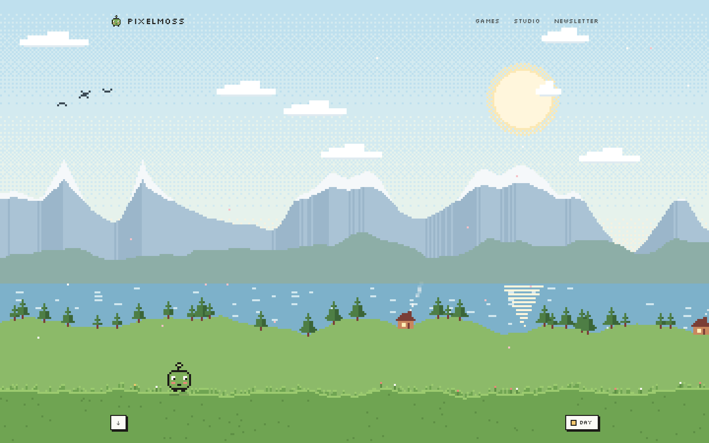

# websites

A collection of small, hand-built websites. Each site lives in its own folder as a self-contained static page: no build step, no dependencies. Open its `index.html` in a browser and it runs.

## Pixelmoss

Pixel-art landing page for a tiny two-person game studio. [View the folder](./pixelmoss)



## Running a site locally

```bash
cd pixelmoss
python3 -m http.server 8000
# then open http://localhost:8000
```

Or just open `index.html` directly in a browser.

## Adding a new site

1. Create a folder named after the site, with an `index.html` and a `screenshots/` folder.
2. Add a screenshot of the opening screen as `screenshots/<site-name>.png`.
3. Add a section above with the site name, a one-line description and the screenshot.
