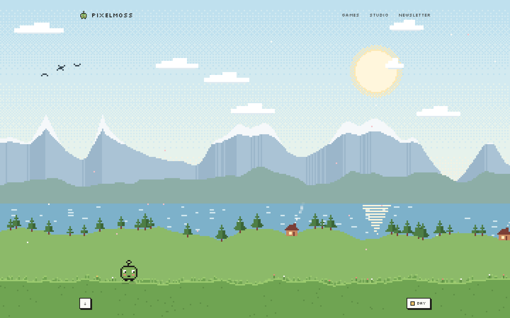

# Pixelmoss

A pixel-art landing page for Pixelmoss, a small two-person game studio making cozy worlds by hand.

Everything is drawn in code on canvas: no image assets, no frameworks, one `index.html`.



## Features

- Animated landscape with mountains, a lake, a cabin, clouds, birds and falling petals.
- Day/Night toggle. Night brings a moon, stars, fireflies and glowing cabin windows, and switches on automatically between 6 PM and 6 AM.
- Animated game windows for Moss Garden, Tidepool Post and Lanternfall.
- Pixel cursor, with a pixel hand over anything clickable.
- Campfire footer with Sprig, the studio mascot, asleep under a tree.

## Run it

Open `index.html` in a browser, or serve the folder:

```bash
python3 -m http.server 8000
```
