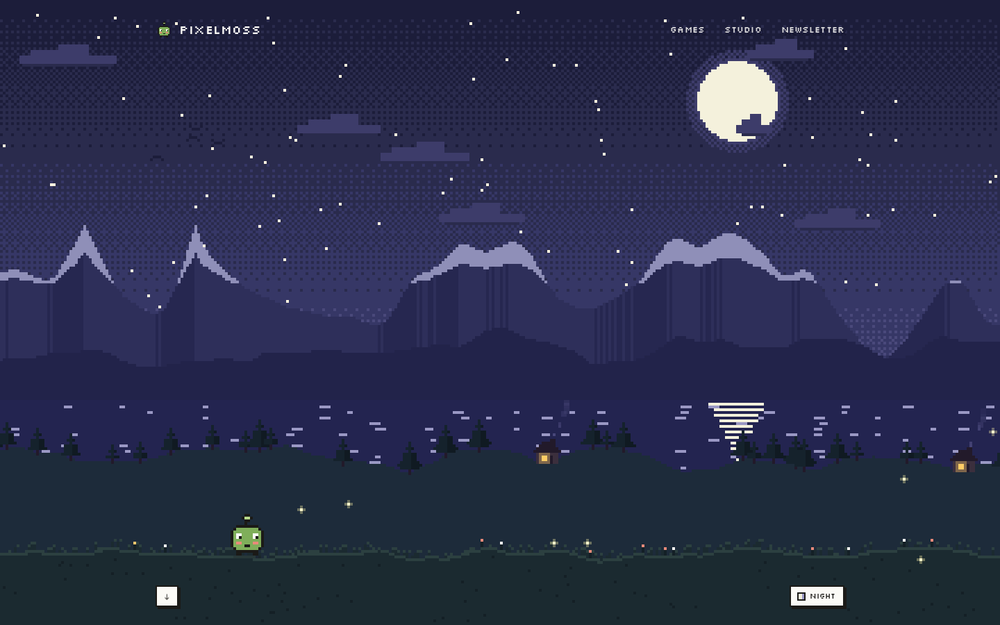
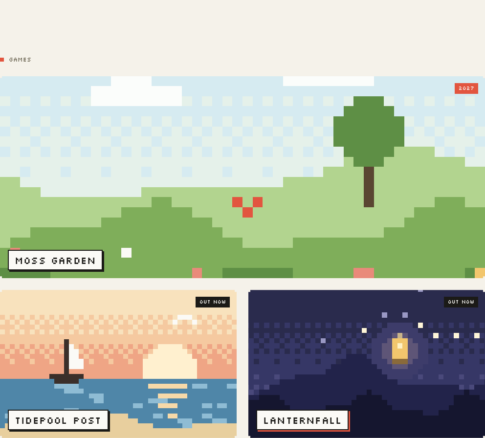
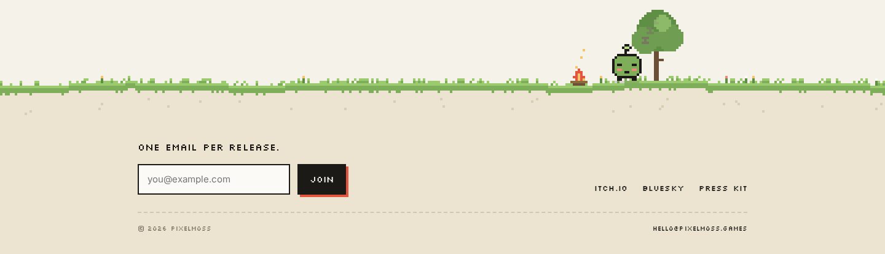

# Pixelmoss

A pixel-art landing page for Pixelmoss, a small two-person game studio making cozy worlds by hand.

Everything is drawn in code on canvas: no image assets, no frameworks, one `index.html`.




## Features

- **Animated landscape hero** with mountains, a lake, a cabin, drifting clouds, birds and falling petals.
- **Day/Night toggle.** Night uses a deep indigo sky with a moon, stars, fireflies and glowing cabin windows. Switches automatically between 6 PM and 6 AM.
- **Animated game windows** for three games:
  - *Moss Garden*: swaying flowers, drifting clouds and a butterfly.
  - *Tidepool Post*: a bobbing sailboat, a passing gull and moving ripples.
  - *Lanternfall*: twinkling stars and a floating, flickering lantern.
- **Pixel cursor**: a chunky pixel arrow, and a pixel hand over anything clickable.
- **Campfire footer** with Sprig, the studio mascot, asleep under a tree.
- Retro 10 fps animation in the game windows and footer, paused when off screen.

## Games



## Footer



## Run it

Open `index.html` in a browser, or serve the folder:

```bash
python3 -m http.server 8000
```

The full-page screenshot is in [screenshots/full-page.png](screenshots/full-page.png).
